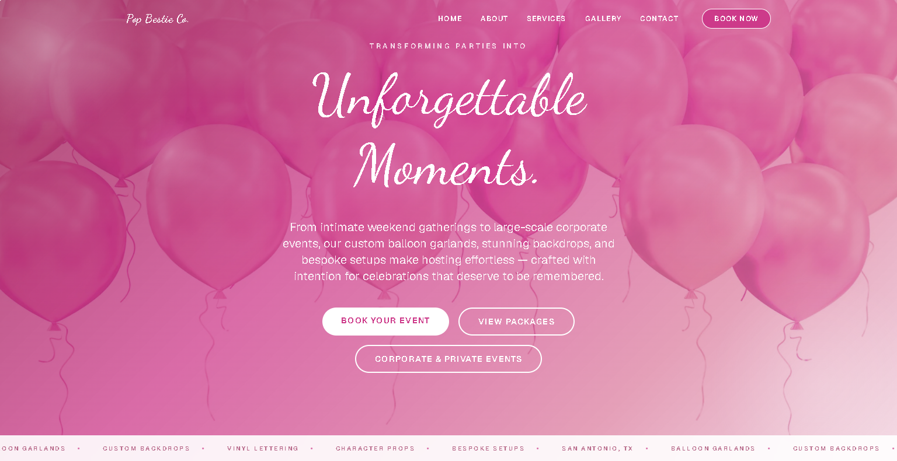

# 🎈 Pop Bestie Co.

**Production website for a San Antonio event-decor business**

[](https://popbestieco.com)




## About the Project

Pop Bestie Co. is a real small business run by Nancy & Jalynn. They create balloon garlands, custom backdrops, and full event setups for birthdays, baby showers, bridal showers, and corporate events in San Antonio, TX.

I designed, built, and deployed the site on my own and still maintain it. I handle everything from architecture and UI design to the email backend and production deployment. The site is how the business brings in new clients: visitors browse past work, compare packages, and send detailed booking requests straight to the owners' inbox.

## ✨ Features

- **Detailed booking form:** collects event date, time, location, type, package, theme, color scheme, custom vinyl text, character props, referral source, and preferred payment method
- **Automatic emails with [Resend](https://resend.com):** each submission sends the business a branded HTML email with every detail, plus a confirmation email to the customer
- **Two audiences:** separate copy and flows for personal celebrations and corporate events
- **Packages and pricing:** clearly laid-out service tiers, from _The Essential Set Up_ to _The Luxe Experience 3.0_
- **Portfolio gallery:** photos of real past events
- **Reviews section:** testimonials from real clients
- **Polished design:** a light editorial theme with a custom pink palette and Cormorant Garamond + DM Sans fonts
- **Analytics:** Vercel Web Analytics tracks traffic
- **SEO and cross-browser support:** page metadata, a custom favicon, and Safari compatibility fixes

## 🛠️ Tech Stack

| Layer           | Technology                                         |
| --------------- | -------------------------------------------------- |
| Framework       | Next.js 16 (App Router)                            |
| UI              | React 19, TypeScript                               |
| Styling         | Tailwind CSS v4                                    |
| Email           | Resend API (Next.js Route Handler)                 |
| Hosting & CI/CD | Vercel (deploys automatically on push to `master`) |
| Analytics       | Vercel Web Analytics                               |

## 📁 Project Structure

```
app/
├── api/contact/route.ts   # API route: sends the business and customer emails
├── layout.tsx             # Root layout, fonts, SEO metadata
├── page.tsx               # Single-page site that puts the sections together
└── globals.css            # Theme tokens and global styles
components/
├── Navbar.tsx    ├── Hero.tsx       ├── About.tsx
├── Services.tsx  ├── Corporate.tsx  ├── Gallery.tsx
├── Reviews.tsx   ├── Contact.tsx    └── Footer.tsx
public/images/    # Real event photography
```

## 🚀 Running Locally

```bash
git clone https://github.com/Sa1vad0r/pop-bestie-co.git
cd pop-bestie-co
npm install
```

Create a `.env.local` file:

```env
RESEND_API_KEY=your_resend_api_key
BUSINESS_EMAIL=where_inquiries_should_go@example.com
```

```bash
npm run dev
```

Open [http://localhost:3000](http://localhost:3000).

## 🔄 Development Workflow

The project uses a branch-and-PR workflow even though I'm the only developer. Each feature, such as the email integration, the theme redesign, and the corporate booking flow, is built on its own branch and merged through a pull request. Every merge to `master` deploys automatically to production on Vercel.

## 📬 Contact

Built by **Salvador Alfaro Jr.** · [LinkedIn](https://www.linkedin.com/in/salvador-alfaro-jr) · [GitHub](https://github.com/Sa1vad0r)

Need a website for your small business? Feel free to reach out!
